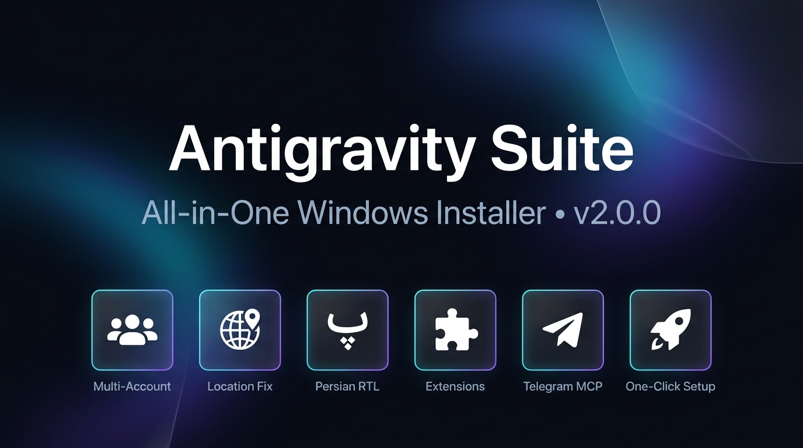
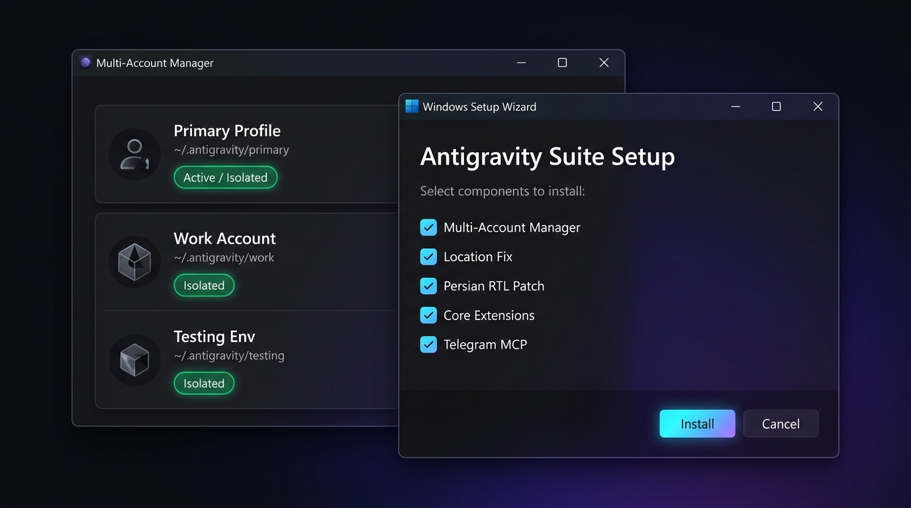

# 🚀 Antigravity Suite — مجموعه کامل و یکپارچه ویندوز

**نصب همه ابزارهای ضروری Antigravity فقط با یک فایل و چند کلیک ساده — بدون نیاز به دانش فنی یا تنظیمات پیچیده!**

[-6366F1?style=for-the-badge)](https://github.com/IrMaho/antigravity-suite-releases/releases/latest)
[-0078D6?style=for-the-badge&logo=windows)](#مشخصات-سیستم-مورد-نیاز)

---

## ✨ داخل این بسته یکپارچه چه امکاناتی وجود دارد؟

با نصب فقط **یک فایل نصاب (`AntigravitySuite-Setup-v2.0.0.exe`)** تمام امکانات زیر به صورت خودکار روی سیستم شما آماده و فعال می‌شود:

| قابلیت | توضیح ساده |
| :--- | :--- |
| 👤 **مدیریت چند اکانت (ایزوله)** | ساخت بی‌نهایت پروفایل کاملاً جداگانه برای استفاده همزمان یا جابه‌جایی سریع بین اکانت‌ها بدون تداخل و پریدن لاگین. |
| 🌍 **فیکس لوکیشن و رفع خطای 403** | برنامه گرافیکی اختصاصی برای برطرف کردن محدودیت‌های منطقه‌ای و خطای دسترسی در محیط Antigravity. |
| 🇮🇷 **راست‌چین هوشمند فارسی + فونت وزیرمتن** | نمایش خوانا، زیبا و استاندارد متن‌های فارسی و ترکیبی در گفتگوها و محیط برنامه (اعمال خودکار هنگام نصب). |
| 🔑 **ورود بی‌دردسر به حساب کاربری** | رفع کامل مشکل باز نشدن صفحه ورود در مرورگر و اتصال روان به حساب گوگل. |
| 🧩 **افزونه‌های آماده** | نصب خودکار افزونه جابه‌جایی سریع اکانت و افزونه هوشمند مدیریت فضای گفتگو. |
| 💬 **ابزار اتصال به تلگرام (Telegram MCP)** | نسخه آماده و کاملاً تمیز برای اتصال هوشمند به تلگرام (با امکان فعال‌سازی یک‌کلیکی از منوی استارت). |

---

## 📸 تصاویر محیط برنامه و نصاب

### محیط مدیریت چند اکانت و نصاب یکپارچه

### محیط برنامه فیکس لوکیشن

---

## ⚡ راهنمای نصب (در کمتر از ۳۰ ثانیه!)

نصب این مجموعه به شدت ساده است و **نیازی به نصب هیچ برنامه جانبی یا دسترسی مدیر سیستم (Administrator)** ندارد:

1. از بخش **[Releases (دانلود آخرین نسخه)](https://github.com/IrMaho/antigravity-suite-releases/releases/latest)** فایل **`AntigravitySuite-Setup-v2.0.0.exe`** را دانلود کنید.
2. روی فایل دانلودشده دابل‌کلیک کنید.
3. فقط دکمه‌های **Next ← Next ← Install** را بزنید (تمام بخش‌ها به صورت پیش‌فرض انتخاب شده‌اند).
4. پس از پایان نصب، میانبر برنامه‌ها روی **دسکتاپ** و **منوی استارت (Start Menu)** شما ساخته می‌شود و تنظیمات فارسی و افزونه‌ها به صورت خودکار اعمال شده‌اند!

> 💡 **نکته:** اگر در آینده خود برنامه Antigravity آپدیت شد، کافیست از منوی استارت گزینه **Apply Persian RTL Patch** را یک بار اجرا کنید تا راست‌چین فارسی دوباره در چند ثانیه فعال شود.

---

## 💻 مشخصات سیستم مورد نیاز

- **سیستم‌عامل:** ویندوز ۱۰ یا ویندوز ۱۱ (نسخه ۶۴ بیتی)
- **فضای مورد نیاز:** حدود ۱۰۰ مگابایت فضای خالی
- **حجم فایل نصاب:** حدود ۳۱.۶ مگابایت
- **پیش‌نیاز:** هیچ پیش‌نیاز اضافه‌ای لازم نیست (همه‌چیز داخل فایل نصاب قرار دارد)

---

## 🔐 امنیت و حریم خصوصی

- این بسته کاملاً پاک و استاندارد آماده شده و **هیچ اطلاعات شخصی، نشست (Session) یا حساب کاربری از پیش واردشده‌ای** داخل آن وجود ندارد.
- تمامی تنظیمات و حساب‌های شما فقط روی سیستم شخصی خودتان ذخیره می‌شوند.
- برای اطمینان از سلامت کامل فایل دانلودشده، فایل `SHA256SUMS.txt` در کنار هر نسخه در صفحه ریلیزها قرار داده شده است.

---

### 📥 آماده شروع هستید؟

**[دانلود مستقیم Antigravity Suite v2.0.0 برای ویندوز](https://github.com/IrMaho/antigravity-suite-releases/releases/latest)**

