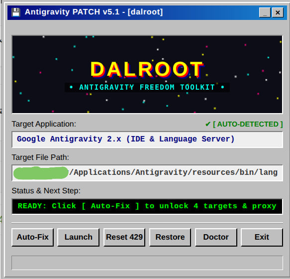

# 🚀 Antigravity Suite — مجموعه کامل و یکپارچه ویندوز

**همه ابزارهای ضروری Antigravity در یک فایل نصاب ساده — بدون نیاز به دانش فنی، بدون تنظیمات پیچیده، آماده استفاده در ۳۰ ثانیه!**

[-0078D6?style=for-the-badge&logo=windows)](#مشخصات-سیستم-مورد-نیاز)

---

## ⚡ نصب سریع (فقط ۳ قدم!)

1. از صفحه **[دانلود آخرین نسخه (Releases)](https://github.com/IrMaho/antigravity-suite-releases/releases/latest)** فایل **`AntigravitySuite-Setup-v2.1.5.exe`** را دانلود کنید.
2. روی فایل دانلودشده دابل‌کلیک کنید و فقط دکمه‌های **Next ← Next ← Install** را بزنید (نیازی به نصب پایتون یا دسترسی Administrator هم ندارد!).
3. تمام! تمام ابزارها، اصلاحات، راست‌چین فارسی، افزونه‌ها و هارنس فیکس به صورت خودکار نصب و فعال می‌شوند و میانبرها روی **دسکتاپ** و **منوی استارت** شما ساخته می‌شوند.

---

## 📸 تصاویر محیط برنامه

### محیط مدیریت چند اکانت و نصاب یکپارچه

### محیط برنامه فیکس لوکیشن

---

## 📖 معرفی و آموزش قدم‌به‌قدم همه قابلیت‌ها (دونه به دونه!)

در ادامه تمام ۷ ابزار موجود در این بسته را به زبان کاملاً ساده توضیح داده‌ایم و یاد می‌گیرید چطور از هرکدام بهترین استفاده را ببرید:

---

### ۱. 👤 مدیریت و ایزوله چند اکانت (`Antigravity Manager`)
**به چه دردی می‌خورد؟**  
به شما اجازه می‌دهد روی یک ویندوز، چندین حساب کاربری مختلف Antigravity را به صورت کاملاً جداگانه (ایزوله) داشته باشید؛ بدون اینکه اکانت‌ها با هم قاطی شوند یا وسط کار از حسابتان خارج شوید.

**چطور از آن استفاده کنیم؟**
1. از روی دسکتاپ یا منوی استارت، برنامه **Antigravity Manager** را باز کنید.
2. روی دکمه **ساخت پروفایل جدید** بزنید و یک اسم دلخواه (مثلاً اکانت کاری یا اکانت دوم) انتخاب کنید.
3. هر زمان خواستید وارد هر اکانت شوید، فقط روی آن پروفایل کلیک کرده و **Launch** را بزنید.
4. حتی می‌توانید برای هر اکانت یک میانبر جداگانه روی دسکتاپ داشته باشید تا با یک کلیک مستقیم وارد همان اکانت شوید!

---

### ۲. 🌍 فیکس لوکیشن و رفع خطای 403 (`Antigravity Location Fixer`)
**به چه دردی می‌خورد؟**  
اگر هنگام باز کردن برنامه با پیام محدودیت منطقه‌ای، خطای 403 یا گیر کردن در مرحله دانلود مواجه می‌شوید، این ابزار به صورت خودکار این مشکل را برطرف می‌کند.

**چطور از آن استفاده کنیم؟**
1. از روی دسکتاپ یا منوی استارت، برنامه **Antigravity Location Fixer** را باز کنید.
2. برنامه به صورت خودکار نصب Antigravity شما را پیدا می‌کند.
3. فقط روی دکمه اصلی فیکس کلیک کنید و منتظر بمانید تا نشانگرهای سبز موفقیت نمایش داده شوند.
4. برنامه Antigravity را یک بار ببندید و دوباره باز کنید؛ مشکل لوکیشن کاملاً رفع شده است!

---

### ۳. 🇮🇷 راست‌چین هوشمند فارسی و فونت وزیرمتن (`Persian RTL`)
**به چه دردی می‌خورد؟**  
متن‌های فارسی در چت و محیط برنامه را کاملاً راست‌به‌چپ، مرتب و با فونت خوانا و زیبای **وزیرمتن (Vazirmatn)** نمایش می‌دهد؛ در حالی که متن‌های انگلیسی و کدها همچنان چپ‌به‌راست و بدون به‌هم‌ریختگی باقی می‌مانند.

**چطور از آن استفاده کنیم؟**
- هنگام نصب **Antigravity Suite** به صورت خودکار فعال می‌شود و نیازی به هیچ کار اضافه‌ای نیست!
- اگر در آینده خود برنامه Antigravity آپدیت شد و ظاهر فارسی به حالت اول برگشت، کافیست از منوی استارت گزینه **`Apply Persian RTL Patch`** را یک بار اجرا کنید تا ظرف چند ثانیه دوباره فعال شود.

---

### ۴. ⚡ هارنس فیکس — افزایش سرعت، ضد هنگ و دستورهای حرفه‌ای (`Gravity Harness Fix`)
**به چه دردی می‌خورد؟**  
باعث می‌شود دستیار هوش مصنوعی شما **چند برابر سریع‌تر، دقیق‌تر و بدون هنگ کردن** کار کند! به صورت خودکار جلوی گیر کردن در حلقه‌های تکراری، خواندن‌های اضافی فایل‌ها و خطاهای حروف ویندوز را می‌گیرد و یک مجموعه کامل از **دستورهای آماده و حرفه‌ای** به چت شما اضافه می‌کند.

**چطور از آن استفاده کنیم؟**
- هنگام نصب به صورت خودکار روی همه پروفایل‌های شما نصب و فعال می‌شود!
- کافیست در محیط چت Antigravity، علامت **`/`** را تایپ کنید و از دستورهای حرفه‌ای زیر استفاده کنید:

| دستور در چت | کاربرد ساده و نحوه استفاده |
| :--- | :--- |
| **`/agile-swarm`** | **انجام سریع و همزمان کارهای بزرگ!** به‌جای انتظار طولانی، کار را به بخش‌های مستقل تقسیم می‌کند و چند دستیار را همزمان بدون تداخل جلو می‌برد (تکمیل پروژه‌های بزرگ در چند دقیقه!). |
| **`/pro-dev`** | **مدیر پروژه هوشمند!** هر کاری دارید (ساخت ویژگی جدید، اصلاح باگ، بررسی پروژه) را با `/pro-dev` بنویسید تا خودش بهترین مسیر را انتخاب و اجرا کند. |
| **`/repo-onboard`** | **شناخت سریع پروژه جدید!** وقتی یک پروژه جدید باز می‌کنید این دستور را بزنید تا ساختار کل پروژه را کامل بشناسد و برای گفتگوهای بعدی به خاطر بسپارد. |
| **`/forensic-audit`** | **عیب‌یابی و بررسی کامل پروژه!** کل پروژه را موشکافی می‌کند و یک گزارش دقیق و خوانا از مشکلات واقعی و نقاط ضعف به شما می‌دهد. |
| **`/harden-fix`** | **رفع اصولی مشکلات!** خطاها و مشکلات گزارش‌شده را به صورت ریشه‌ای و امن برطرف می‌کند بدون اینکه بخش‌های سالم را خراب کند. |
| **`/figma-to-prod`** | **تبدیل طراحی به خروجی واقعی!** برای پیاده‌سازی دقیق رابط کاربری از روی طراحی. |
| **`/lossless-modularize`** | **مرتب‌سازی و بخش‌بندی تمیز!** بخش‌های شلوغ و بزرگ را بدون حذف هیچ امکاناتی مرتب و سبک می‌کند. |
| **`/memory-sync`** | **به‌روزرسانی حافظه پروژه!** تغییرات جدید را در حافظه پروژه ثبت می‌کند تا دستیار همیشه به‌روز باشد. |
| **`/truthful-readme`** | **نوشتن معرفی دقیق و واقعی!** یک معرفی شفاف و بدون اغراق برای پروژه شما آماده می‌کند. |

> 💡 **نکته:** اگر بعداً پروفایل جدیدی ساختید، کافیست از منوی استارت گزینه **`Install or Update Gravity Harness Fix`** را یک بار اجرا کنید تا روی پروفایل جدید هم فعال شود.

---

### ۵. 🔑 رفع کامل مشکل ورود به حساب گوگل (`Seamless Login Fix`)
**به چه دردی می‌خورد؟**  
در بعضی سیستم‌های ویندوز هنگام کلیک روی دکمه ورود (Sign In)، مرورگر باز نمی‌شود یا لینک ورود عمل نمی‌کند. این اصلاحیه مشکل را یک‌بار برای همیشه برطرف می‌کند و لینک ورود را همزمان در مرورگر باز کرده و در حافظه کپی (Clipboard) هم قرار می‌دهد.

**چطور از آن استفاده کنیم؟**
- هنگام نصب به صورت خودکار اعمال می‌شود. در صورت آپدیت شدن Antigravity می‌توانید از منوی استارت گزینه **`Apply Isolation & Browser Fix`** را اجرا کنید.

---

### ۶. 🧩 افزونه‌های آماده داخل محیط برنامه (`Extensions`)
دو افزونه کاربردی به صورت خودکار هنگام نصب در برنامه شما قرار می‌گیرند:
1. **افزونه جابه‌جایی سریع اکانت (Account Switcher):** بدون نیاز به بستن برنامه، وضعیت سهمیه اکانت‌ها را ببینید و با یک کلیک بین اکانت‌هایتان جابه‌جا شوید.
2. **افزونه محافظ حافظه گفتگو (Context Guard):** به شما نشان می‌دهد چقدر از ظرفیت حافظه چت پر شده است و کمک می‌کند گفتگوهایتان همیشه روان و سریع بمانند.

---

### ۷. 💬 ابزار اتصال به تلگرام (`Telegram MCP`) — کاملاً پاک و بدون سشن شخصی
**به چه دردی می‌خورد؟**  
به دستیار هوش مصنوعی اجازه می‌دهد با اجازه خودتان، پیام‌ها و کانال‌های تلگرام شما را بخواند، جستجو کند یا پیام ارسال کند.

**چطور از آن استفاده کنیم؟**
1. این بخش کاملاً تمیز نصب می‌شود و **هیچ اکانت یا سشن از پیش واردشده‌ای داخل آن نیست**.
2. هر زمان خواستید این قابلیت را فعال کنید، از منوی استارت گزینه **`Register Telegram MCP to Antigravity`** را یک بار اجرا کنید.
3. سپس با حساب تلگرام شخصی خودتان وارد شوید تا اتصال امن برقرار شود.

---

## 💻 مشخصات سیستم مورد نیاز

- **سیستم‌عامل:** ویندوز ۱۰ یا ویندوز ۱۱ (۶۴ بیتی)
- **فضای مورد نیاز:** حدود ۱۲۰ مگابایت فضای خالی
- **پیش‌نیاز:** هیچ پیش‌نیاز اضافه‌ای لازم نیست — همه‌چیز داخل فایل نصاب آماده است!

---

## 🔐 امنیت و حریم خصوصی

- این مجموعه کاملاً پاک ساخته شده و **هیچ سشن تلگرام، حساب گوگل، رمز عبور یا اطلاعات شخصی** در آن وجود ندارد.
- تمامی اطلاعات و اکانت‌های شما فقط روی کامپیوتر شخصی خودتان باقی می‌مانند.
- برای اطمینان از سلامت کامل فایل دانلودشده، کد اعتبارسنجی `SHA-256` در کنار فایل نصاب در صفحه ریلیزها قرار داده شده است.

---

## 🧹 بازگردانی کامل به حالت اولیه (Uninstaller / Factory Reset)

اگر به هر دلیلی (مثل تست مجدد یا ضبط آموزش از صفر) می‌خواهید **تمام تغییرات، پچ‌ها و تنظیمات به حالت کارخانه و قبل از نصب برگردد**، فایل **`AntigravitySuite-Uninstaller.exe`** را از صفحه ریلیزها دانلود و اجرا کنید:

- **حذف کامل پچ فیکس لوکیشن و تحریم (403 / Region Bypass):** فایل‌های اصلی `Antigravity IDE` و `agy` به نسخه خام اولیه برمی‌گردند (بعد از آن، خطای ریجن/لوکیشن ایران دوباره مثل روز اول ظاهر می‌شود).
- **حذف راست‌چین فارسی و فونت وزیرمتن** و بازگردانی ظاهر پیش‌فرض ادیتور.
- **حذف پچ ایزولاسیون و رفع باگ مرورگر.**
- **حذف افزونه‌های نصب‌شده** (`Account Switcher` و `Context Guard`) و **هارنس فیکس (`Gravity Harness Fix`)**.
- **پاک‌سازی کش لاگین و ریجن (`.gemini` و `AppData`)** تا هنگام باز کردن یا نصب مجدد Antigravity IDE، سیستم دقیقاً مثل یک ویندوز کاملاً خام عمل کند.
- **حذف فایل‌های نصبی و میانبرهای `Antigravity Suite`** از دسکتاپ و منوی استارت (همراه با گزینه اختیاری برای نگه داشتن یا پاک کردن پروفایل‌های ایزوله).

**[⬇️ دانلود فایل بازگردانی به حالت اولیه (`AntigravitySuite-Uninstaller.exe`)](https://github.com/IrMaho/antigravity-suite-releases/releases/latest)**

---

### 📥 آماده شروع هستید؟

**[⬇️ دانلود مستقیم Antigravity Suite v2.1.5 برای ویندوز](https://github.com/IrMaho/antigravity-suite-releases/releases/latest)**

